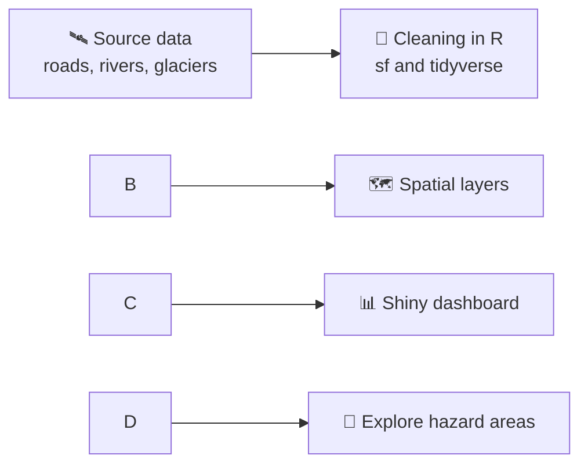

<p align="center">
  
</p>

# 🏔️ Landslide \& Flash Flood Early-Insight Dashboard

An interactive R Shiny dashboard that helps anticipate **landslide** and **flash flood** activity across four regions of India, using spatial data on rivers, roads, glaciers and terrain.

[!\[R](https://img.shields.io/badge/R-4.x-276DC3?logo=r&logoColor=white)](https://www.r-project.org/)
[!\[Shiny](https://img.shields.io/badge/built%20with-Shiny-blue)](https://shiny.posit.co/)
\[!\[Course](https://img.shields.io/badge/course-STAT3037A-orange)]()
[!\[License](https://img.shields.io/badge/license-MIT-green)](LICENSE)

<p align="center">
  <a href="https://YOUR-APP-LINK.shinyapps.io/dashboard/">
    
  </a>
</p>

<p align="center">
  
</p>

* [Overview](#-overview)
* [Study regions](#-study-regions)
* [Screenshots](#-screenshots)
* [Getting started](#-getting-started)
* [Data](#-data)
* [Project structure](#-project-structure)
* [Limitations](#-limitations)
* [Team](#-team)
* [Contributing](#-contributing)
* [License](#-license)

\---

## 🔍 Overview

Landslides and flash floods are among the most damaging hazards in mountainous and glacier-fed regions. This dashboard brings together river networks, road infrastructure and glacier data so users can explore where hazard activity is most likely and which communities and routes are exposed.

**What you can do with it**

* Explore hazard-relevant layers on an interactive map
* Compare the four study regions side by side
* See which roads and river systems fall in higher-risk areas
* description

### How it works



### Features

|🗺️ Interactive map|📈 Region comparison|🛣️ Exposure|
|:-:|:-:|:-:|
|Toggle roads, rivers and glacier layers|Compare the four study regions|See which routes sit in higher-risk zones|

\---

## 🗺️ Study regions

|#|Region|Notes|
|-|-|-|
|1|description|description|
|2|description|description|
|3|description|description|
|4|description|description|

\---

## 🖼️ Screenshots

<p align="center">
  
</p>

\---

## 🚀 Getting started

### Prerequisites

* R (>= 4.2)
* RStudio or Positron (optional)

### Installation

```r
# Clone the repo, open the project folder in R, then:
renv::restore()
```

### Run the app

```r
shiny::runApp()
```

\---

## 🗂️ Data

<details>
<summary><b>Click to see the datasets used</b></summary>

All source details are listed in [`docs/`](docs/).

|Dataset|Description|Location|
|-|-|-|
|Road networks|Bharatmala and other road networks in India|`data/roads/`|
|Rivers and streams|River network from India-WRIS|`data/rivers/`|
|Boundaries and glaciers|India shapefile and glacier data|`data/boundaries/`|

</details>

\---

## 📁 Project structure

```
.
├── assets/       # Banner and screenshots
├── data/
│   ├── roads/        # Road network data
│   ├── rivers/       # River and stream data
│   └── boundaries/   # India shapefile and glacier data
├── docs/         # Data sources and metadata
├── R/            # R / Shiny code
└── README.md
```

\---

## ⚠️ Limitations

This is an academic project and **not an official early-warning system**. Do not use it to make safety or evacuation decisions. Always follow guidance from national and local disaster management authorities.

\---

## 👥 Team

STAT3037A project team: description

\---

## 🤝 Contributing

Contributions are welcome. See [CONTRIBUTING.md](CONTRIBUTING.md) to get started.

\---

## 📜 License

Released under the [MIT License](LICENSE). Data remains subject to the terms of its original sources (see `docs/`).

