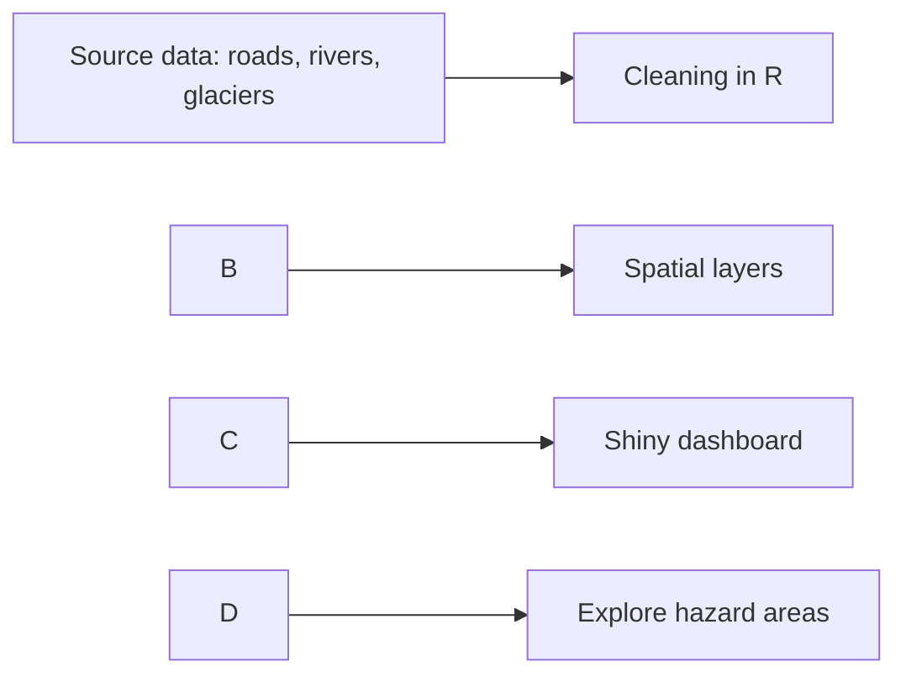

<p align="center">
  <a href="https://hv21.shinyapps.io/STAT3037A_APP1/">
    
  </a>
</p>

# Glacier Collapse in India

An interactive R Shiny dashboard that helps anticipate **landslide** and **flash flood** activity across four Himalayan regions of India: Ladakh, Himachal Pradesh, Uttarakhand and Jammu \& Kashmir. It uses spatial data on rivers, roads, glaciers and terrain.


<p align="center">
  <a href="https://YOUR-USERNAME.shinyapps.io/YOUR-APP-NAME/">
    
  </a>
  <br>
  <sub><b>Click the flag to launch the dashboard</b></sub>
</p>


## Contents

* [Overview](#-overview)
* [Study regions](#-study-regions)
* [Project status](#-project-status)
* [Getting started](#-getting-started)
* [Data](#-data)
* [Project structure](#-project-structure)
* [Limitations](#-limitations)
* [Team](#-team)


## Overview

Landslides and flash floods are among the most damaging hazards in mountainous and glacier-fed regions. This dashboard brings together river networks, road infrastructure and glacier data so users can explore where hazard activity is most likely and which routes are exposed.

**What you can do with it**

* Explore hazard-relevant layers on an interactive map
* Compare the four study regions side by side
* See which roads and river systems fall in higher-risk areas
* description

### How it works




## Study regions

|#|Region|Why it matters|
|-|-|-|
|1|**Ladakh**|High-altitude, glacier-rich Union Territory with steep river valleys and exposure to flash floods|
|2|**Himachal Pradesh**|Mountainous state with frequent monsoon landslides along road corridors|
|3|**Uttarakhand**|Glacier-fed rivers and steep slopes, with a history of major flash floods|
|4|**Jammu \& Kashmir**|Himalayan and Pir Panjal terrain, with river basins and road links vulnerable to slope failure and flooding|


## Project status

This dashboard is **under active development**.

* \[x] Collect road, river and glacier datasets
* \[x] Organise repository and documentation
* \[x] Clean and combine spatial layers for the four regions
* \[x] Build the interactive map
* \[x] Add region comparison views
* \[x] Add hazard indicators
* \[ ] Deploy the app online
* \[ ] Add screenshots and a demo GIF


## Getting started

**Prerequisites:** R (version 4.2 or newer). RStudio is recommended.

**Run the app:** clone this repository, open the project folder in RStudio, then run:

```r
shiny::runApp()
```


## Data

Full source details are in the [`docs/`](docs/) folder.

|Dataset|Description|Location|
|-|-|-|
|Road networks|Bharatmala and other road networks in India|`data/roads/`|
|Rivers and streams|River network from India-WRIS|`data/rivers/`|
|Boundaries and glaciers|India shapefile and glacier data|`data/boundaries/`|


## Project structure

```
.
├── assets/       Banner and screenshots
├── data/
│   ├── roads/        Road network data
│   ├── rivers/       River and stream data
│   └── boundaries/   India shapefile and glacier data
├── docs/         Data sources and metadata
├── R/            R and Shiny code
└── README.md
```


## Limitations

This is an academic project and **not an official early-warning system**. Please do not use it to make safety or evacuation decisions. Always follow guidance from national and local disaster management authorities.


## Team

STAT3037A project team: Hannah Venter, Sayeeda Naidoo, Oratilwe Tau, Nomzamo Dlomo.

