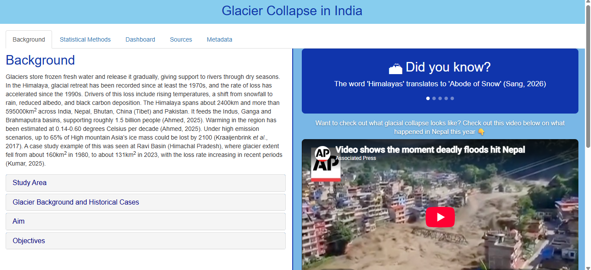
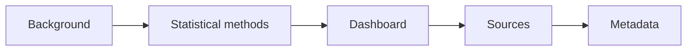

<p align="center">
  <a href="https://hv21.shinyapps.io/STAT3037A_APP1/">
    
  </a>
</p>

# Glacier Collapse in India

An interactive R Shiny dashboard that helps anticipate **landslide** and **flash flood** activity across four Himalayan regions of India: Ladakh, Himachal Pradesh, Uttarakhand and Jammu & Kashmir. It uses spatial data on rivers, roads, glaciers and terrain.

<p align="center">
  <a href="https://hv21.shinyapps.io/STAT3037A_APP1/">
    
  </a>
  <br>
  <sub><b>Click the flag to launch the dashboard</b></sub>
</p>

---

## Contents

- [Overview](#overview)
- [Study regions](#study-regions)
- [Deployment workflow](#deployment-workflow)
- [Getting started](#getting-started)
- [Data](#data)
- [Project structure](#project-structure)
- [Disclaimer](#disclaimer)
- [Team](#team)

---

## Overview

Landslides and flash floods are among the most damaging hazards in mountainous and glacier-fed regions. This dashboard brings together river networks, road infrastructure and glacier data so users can explore where hazard activity is most likely and which routes are exposed.

### Aim

To identify settlements susceptible to glacial collapse and flash floods, based on their distance from glaciers, so authorities can plan evacuation or relocation early.

### Objectives

1. Map glaciers and glacial lakes across Ladakh, Uttarakhand, Himachal Pradesh and Jammu & Kashmir.
2. Measure the distance from settlements to glaciers, along rivers and roads, to rank which communities face the highest risk.
3. Give government and planners a reproducible, interactive tool to prioritise evacuation and relocation planning.

### What you can do with it

- Explore hazard-relevant layers on an interactive map
- Compare the four study regions side by side
- See which roads and river systems fall in higher-risk areas
- description

<p align="center">
  
</p>

<details open>
<summary><b>How it works</b> (click to collapse or expand)</summary>



</details>

---

## Study regions

| # | Region | Why it matters |
| - | ------ | -------------- |
| 1 | **Ladakh** | High-altitude, glacier-rich Union Territory with steep river valleys and exposure to flash floods |
| 2 | **Himachal Pradesh** | Mountainous state with frequent monsoon landslides along road corridors |
| 3 | **Uttarakhand** | Glacier-fed rivers and steep slopes, with a history of major flash floods |
| 4 | **Jammu & Kashmir** | Himalayan and Pir Panjal terrain, with river basins and road links vulnerable to slope failure and flooding |

---

## Deployment workflow

The steps from raw data to the live dashboard:

- [x] Collect road, river and glacier datasets
- [x] Organise repository and documentation
- [x] Clean and combine spatial layers for the four regions
- [x] Build the interactive map
- [x] Add region comparison views
- [x] Add hazard indicators
- [x] Deploy the app online
- [x] Add a screenshot
- [x] Add a demo GIF

---

## Getting started

**Prerequisites:** R (version 4.2 or newer). RStudio is recommended.

**Run the app:** clone this repository, open the project folder in RStudio, then run:

```r
shiny::runApp()
```

### Code walkthrough

Click a step to see the code and what it does.

<details>
<summary><b>1 · Load packages</b></summary>

```r
library(shiny)     # the app framework
library(sf)        # reading and measuring spatial data
library(leaflet)   # interactive maps
library(dplyr)     # data wrangling
```

**What it does:** loads the tools the app needs. Each package is used later for a different job: building the app, handling shapefiles, drawing the map, and tidying tables.

</details>

<details>
<summary><b>2 · Load the data</b></summary>

```r
glaciers <- st_read("data/boundaries/your_glacier_file.shp")
rivers   <- st_read("data/rivers/your_river_file.shp")
roads    <- st_read("data/roads/your_road_file.shp")
```

**What it does:** reads the spatial files from the `data/` folders into R. Each file becomes a table where every row is a shape (a glacier, a river segment or a road) with its location attached.

</details>

<details>
<summary><b>3 · Calculate distances</b></summary>

```r
# Distance (in metres) from each settlement to the nearest glacier
settlements$dist_glacier <- apply(st_distance(settlements, glaciers), 1, min)
```

**What it does:** measures how far each settlement is from the closest glacier. Settlements with smaller distances are ranked as higher risk.

</details>

<details>
<summary><b>4 · Build the user interface (UI)</b></summary>

```r
ui <- fluidPage(
  titlePanel("Glacier Collapse in India"),
  sidebarLayout(
    sidebarPanel(
      selectInput("region", "Region",
                  choices = c("Ladakh", "Himachal Pradesh",
                              "Uttarakhand", "Jammu & Kashmir"))
    ),
    mainPanel(leafletOutput("map"))
  )
)
```

**What it does:** lays out the page. The sidebar holds the region selector and the main panel holds the map.

</details>

<details>
<summary><b>5 · Write the server logic</b></summary>

```r
server <- function(input, output) {
  output$map <- renderLeaflet({
    leaflet() |>
      addTiles() |>
      addPolygons(data = glaciers)
  })
}
```

**What it does:** tells the app what to show. It draws the map and updates it when the user changes the selection.

</details>

<details>
<summary><b>6 · Run the app</b></summary>

```r
shinyApp(ui, server)
```

**What it does:** joins the interface and the server logic into a working app.

</details>

---

## Data

Full source details are in the [`docs/`](docs/) folder.

| Dataset | Description | Location |
| ------- | ----------- | -------- |
| Road networks | Bharatmala and other road networks in India | `data/roads/` |
| Rivers and streams | River network from India-WRIS | `data/rivers/` |
| Boundaries and glaciers | India shapefile and glacier data | `data/boundaries/` |

---

## Project structure

```
.
├── assets/       Banner and screenshots
├── data/
│   ├── roads/        Road network data
│   ├── rivers/       River and stream data
│   └── boundaries/   India shapefile and glacier data
├── docs/         Data sources and metadata
├── R/            R and Shiny code
└── README.md
```

---

## Disclaimer

This is an academic project and **not an official early-warning system**. Please do not use it to make safety or evacuation decisions. Always follow guidance from national and local disaster management authorities.

---

## Team

STAT3037A project team: Hannah Venter, Sayeeda Naidoo, Oratilwe Tau, Nomzamo Dlomo.
